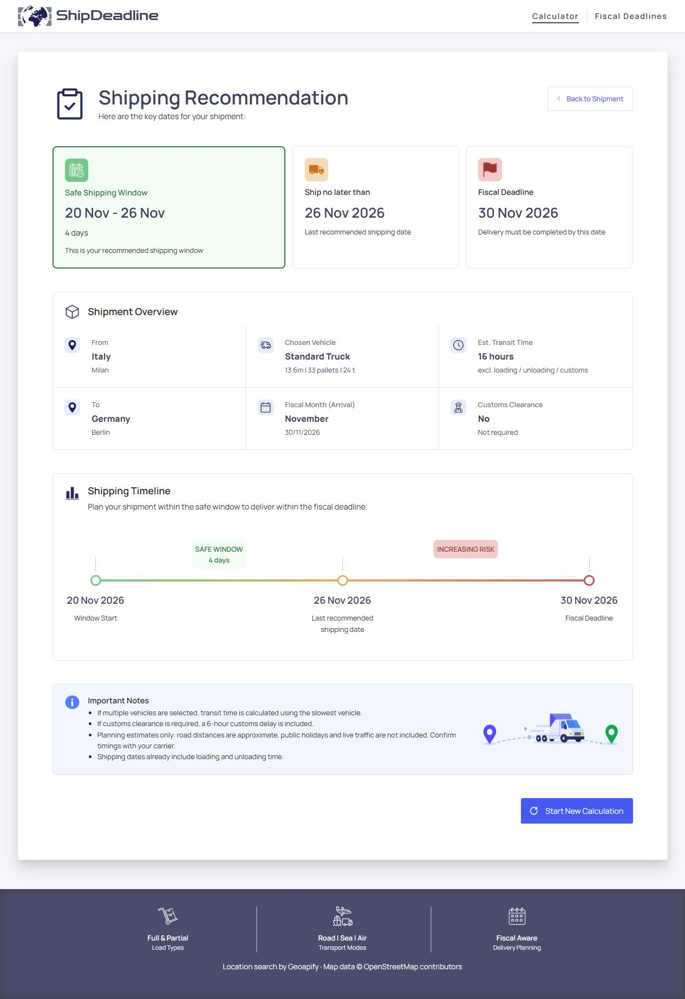

# ShipDeadline

A logistics planning tool that estimates departure windows against a target fiscal closing date.

I developed ShipDeadline to address a problem I experienced: working backwards from a fiscal closing date to determine when a shipment should leave.

Live demo: [Try ShipDeadline](https://sarah-voss.github.io/ShipDeadline/)




## The Problem

Shipment planning often involves gathering transit times from multiple carriers and checking them against internal fiscal deadlines.

Missing a fiscal month cut-off can also affect revenue reporting.


## The Solution

ShipDeadline estimates a recommended departure window and latest departure date based on a few key inputs: origin, destination, vehicles, and target fiscal month.

It provides a starting point for planning. Confirm actual transit times and availability with your carrier.


## Features

### Fiscal deadlines
- Set a custom closing date for each month of the fiscal year (2026 and 2027)
- Defaults to the last calendar day of the month when no custom date is set
- Save one month at a time or all changes at once
- Saved in the browser (localStorage) and used by the calculator

### Route
- Country, postcode and city autocomplete powered by the [Geoapify](https://www.geoapify.com/) geocoding API
- Selecting a postcode fills in the city, and vice versa
- Validation: departure must be in Europe, destination cannot match the departure
- Fiscal month picker that disables past months, unless their closing date (set in the following month) has not passed yet

### Full load road shipments (FTL)
- Three vehicle types: Standard Truck, Van, Exceptional Load
- Up to three vehicles per shipment, each of a different type

### Result
- Safe shipping window, last recommended shipping date and fiscal deadline
- Visual timeline from the safe window to the deadline
- Shipment overview: route, vehicle used for the estimate, transit time, customs
- Dedicated message when the shipment can still leave on the deadline day itself

### General
- Progress is kept across page reloads
- Responsive layout from mobile to desktop
- Keyboard navigation, screen reader labels and reduced motion support. This is not a claim of audited WCAG conformance.


## How the Calculation Works

1. Distance: straight-line (haversine) distance between the two locations, increased by 30% to approximate the road distance
2. Driving time: distance divided by the speed of the slowest selected vehicle (Standard Truck 70 km/h, Van 85 km/h, Exceptional Load 45 km/h)
3. Total time: driving time + 6 hours of customs when either country is outside the EU customs union + the longest loading time among the vehicles
4. Transit days: up to 8 hours the shipment can leave and arrive on the same working day; otherwise the time is split into days of a simplified allowance of 9 hours per day; this is a planning assumption, not a driver-hours compliance model
5. Dates: a fiscal deadline on a weekend moves back to Friday; the last shipping date is the deadline minus the transit days, counting working days only; the safe window starts 4 working days earlier

All results are estimates meant for planning, not carrier commitments.


## Tech Stack

- HTML, CSS and vanilla JavaScript (ES modules)
- No frontend framework or bundler
- [Geoapify Autocomplete API](https://www.geoapify.com/address-autocomplete) for location search
- Google Fonts (Manrope, Zen Dots)


## Project Structure

```
css/
  main.css              Imports every layer in cascade order
  base.css, layout.css  Element defaults and page layout
  components.css        Components shared by both pages
  pages/                Page-specific styles (calculator split by area)
  utilities.css         State and utility classes, loaded last
js/
  pages/                Find the DOM nodes of each page and start its controller
  features/
    calculator/
      controllers/      Handle events and coordinate state and rendering
      renderers/        Update the DOM only, from the data they receive
      logic/            Pure business rules and transit calculation
      shipment/         Vehicle and scenario configuration
      state.js          Calculator state (saved to localStorage)
    fiscal-months/      Fiscal deadlines page: state, storage, rendering
  services/             Geoapify API access
  utils/                Date and DOM helpers
```

Controllers coordinate events and state, renderers update the interface, and calculation rules live in `logic/`. This keeps the core calculations testable independently of the browser.


## Run Locally (Optional)

The [live demo](https://sarah-voss.github.io/ShipDeadline/) needs no account or installation. These instructions are for running and exploring the source code on your own computer.

1. Clone the repository
   ```
   git clone https://github.com/sarah-voss/ShipDeadline.git
   ```
2. Create a free API key at [geoapify.com](https://www.geoapify.com/)
3. Copy `js/services/env.example.js` to `js/services/env.js` and paste your key:
   ```js
   export const GEOAPIFY_API_KEY = 'your_api_key_here';
   ```
   `env.js` is ignored by Git. This does not make the deployed key secret: browser JavaScript and network requests are visible to visitors. Use a separate production key restricted to the deployed origin/referrer. Do not commit unrestricted keys. See [Geoapify key restrictions](https://myprojects.geoapify.com/help/api-keys/).
4. Serve the project with a local server (ES modules do not load from `file://`), for example the VS Code Live Server extension, and open `index.html`


## Tests and Deployment

The application itself needs no package installation or frontend build tool. Node.js 22+ is used only for the test command and deployment packaging.

```sh
npm test
```

The tests cover local calendar dates in three time zones, weekend handling, the planning buffer, approximate distances, multi-vehicle/customs assumptions and leap years.

See [Publishing on GitHub Pages](docs/PUBLISHING.md). The workflow packages only the public HTML, CSS, JavaScript and assets into `_site/`; it generates the browser configuration from a GitHub Actions secret named `GEOAPIFY_API_KEY`. Keeping the key in Actions avoids committing it, but does not hide it in the published site.

## Known Limitations

- Only full load road shipments within Europe are calculated; the other modes show a "coming soon" message
- Public holidays are not considered, only weekends
- Distances are approximated from coordinates, not from real road routes
- Fiscal years are limited to 2026 and 2027
- Traffic, carrier schedules, ferry/tunnel services and exceptional-load permits are not modelled
- The customs allowance is fixed and cannot predict actual clearance time
- A selected current-month deadline can produce a departure date already in the past; check the result before planning
- Data is stored only in the current browser


## Possible Future Improvements

Potential additions include:

- Full load sea shipments (FCL): document cut-off dates, port-to-door transit times
- Partial load road (LTL / groupage)
- Partial load air (express and standard)


## Credits and Author

Developed by [Sarah Voss](https://github.com/sarah-voss).

Location search: [Geoapify](https://www.geoapify.com/). Map data: [OpenStreetMap contributors](https://www.openstreetmap.org/copyright).

© 2026 Sarah Voss. Third-party services and assets belong to their respective owners.
